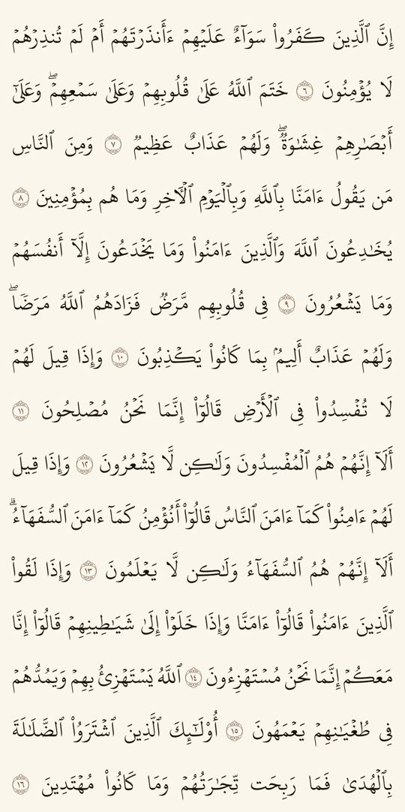
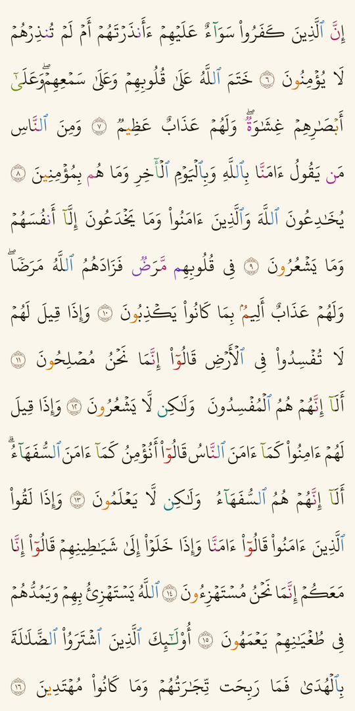
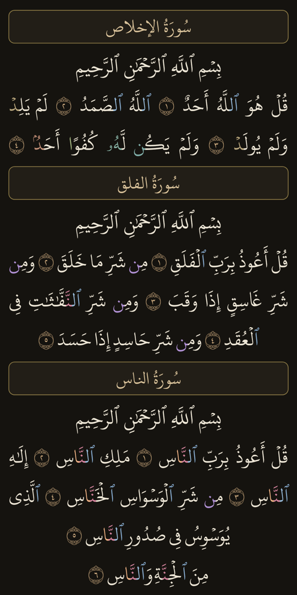
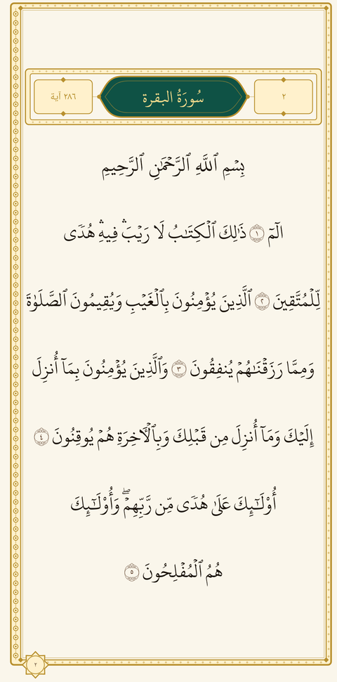
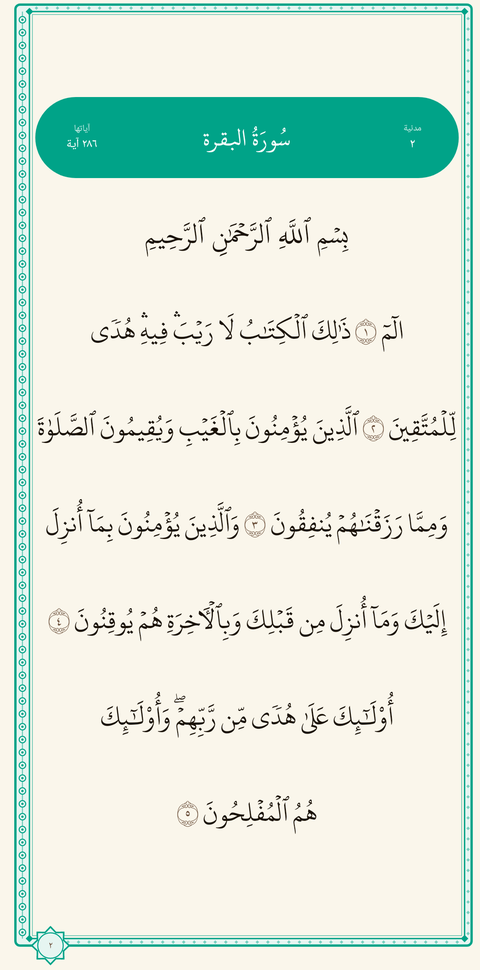
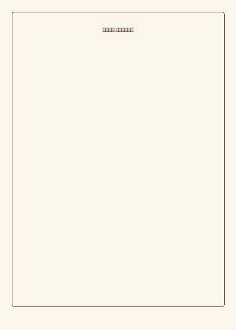
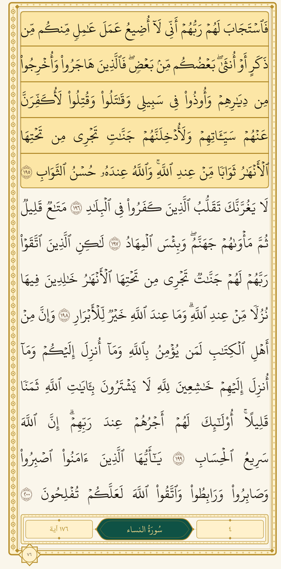
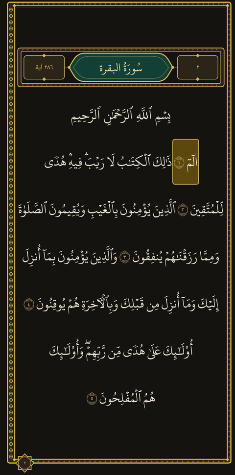

# mushaf-text (customizable fork)

[](https://jitpack.io/#MahmoudMabrok/mushaf-text-customizable)

**Fork** of [sherifshabans/mushaf-text](https://github.com/sherifshabans/mushaf-text) that adds
`MushafDecoration` — ornamental page frames, three surah-header styles, and padded ayah frames —
matching the styles used in the customized reader of QuranyApp.

**English** · [العربية](#العربية)

> **1.5.0 — the decoration release.** The frame now owns the text area, the surah header is a full
> Classic cartouche with the ayah count and the surah number in side panels, and `ayahFrame`
> actually draws. See [CHANGELOG.md](CHANGELOG.md).

---

## English

The Madinah Mushaf rendered as **text** in Jetpack Compose — every page laid out line-for-line
like the printed copy, in the King Fahd Complex font, with an optional colour-coded **tajweed**
mode in which every rule carries its source.

| Plain | Tajweed | Night |
|---|---|---|
|  |  |  |

### Features

- 604 pages, 15 lines each, and the line breaks are **the printed ones**, not an approximation —
  the stretched and half-width lines were measured from images of the mushaf.
- The **KFGQPC HAFS Uthmanic Script** font, so the stacked tanween and the numbered ayah rosette
  come out right.
- 26 tajweed rules, a colour each. Tapping a coloured letter returns the rule, its explanation
  and **its reference**. Colouring **moves nothing** on the page, and a test pins that.
- **Decoration** (`MushafDecoration`): an ornate page frame, `CLASSIC` / `MODERN` / `PLAIN`
  surah headers, and a padded frame around highlighted ayahs.
- Fully offline: text, font and layout all ship inside the library. No network, no API.

The next milestone — a bound-book page turn, hizb and juz marks on the frame,
more printed styles, and host-supplied headers and frames — is specified in
[`docs/roadmap/next-mushaf-reader.md`](docs/roadmap/next-mushaf-reader.md).
That file is a plan. Those features are not in this version.

### Installation

**1.** Add JitPack to `settings.gradle.kts`:

```kotlin
dependencyResolutionManagement {
    repositories {
        google()
        mavenCentral()
        maven { url = uri("https://jitpack.io") }
    }
}
```

**2.** Add the library to your module's `build.gradle.kts`:

```kotlin
dependencies {
    implementation("com.github.sherifshabans:mushaf-text:1.5.0")
}
```

Groovy (`build.gradle`):

```groovy
repositories { maven { url 'https://jitpack.io' } }
dependencies { implementation 'com.github.sherifshabans:mushaf-text:1.5.0' }
```

Requirements: `minSdk 21` and Jetpack Compose. The library adds about 1.7 MB to an app
(1.4 MB of text plus a 0.24 MB font).

### The whole mushaf, page by page

```kotlin
MushafPager(
    modifier = Modifier.fillMaxSize(),
    state = rememberMushafPagerState(initialPage = 1),   // page 1..604
    tajweed = false,                                     // true = tajweed mushaf
    colors = MushafColors.Light,                         // or MushafColors.Dark
    onAyahClick = { ayah -> /* ayah.surah, ayah.number, ayah.text */ }
)
```

Pages turn right to left like the printed copy, whatever the app's locale.

### A single page

```kotlin
MushafPage(
    page = 50,
    modifier = Modifier.fillMaxSize().background(MushafColors.Light.paper),
    tajweed = true
)
```

The page picks the largest font size that fits its widest line into the width it is given, and
ignores the system font scale on purpose: it is a copy of a printed page, and scaling breaks the
fifteen lines. For text that follows the reader's own settings, use `QuranText`.

### Tajweed mode

```kotlin
var hit by remember { mutableStateOf<TajweedHit?>(null) }

MushafPage(
    page = 3,
    tajweed = true,
    naturalMadd = false,          // natural madd is off by default — it paints the whole page
    onTajweedClick = { hit = it } // a coloured letter was tapped
)

hit?.let {
    Text("${it.rule.label}: ${it.rule.definition} — ${it.rule.amount}")
    Text("${it.rule.source}\n${it.rule.evidence}")   // the reference
}

TajweedLegend()                   // the colour key
```

Every `TajweedRule` carries `label` (its Arabic name), `englishName`, `definition`, `amount`,
`letters`, `color`, and `source` / `evidence` — the reference and the verse it comes from.

To override individual rule colours:

```kotlin
val colors = MushafColors.Light.copy(
    tajweed = mapOf(TajweedRule.GHUNNA to Color(0xFFE91E63))
)
```

`focusRule` + `focusIndex` frame one occurrence of a rule on the page — what a "rules on this
page" screen needs to walk through them.

### Page decoration (`MushafDecoration`)

```kotlin
val decoration = MushafDecoration(
    pageFrame = true,                            // ornate frame around the page
    surahHeaderStyle = SurahHeaderStyle.CLASSIC, // CLASSIC | MODERN | PLAIN
    ayahFrame = true                             // padded frame around highlighted ayahs
)

MushafPage(
    page = 2,
    colors = MushafColors.Light,
    decoration = decoration
)

// or through MushafPager
MushafPager(
    decoration = MushafDecoration.Classic,       // or .Modern, or .None
    colors = MushafColors.Light
)
```

| Classic | Modern | Plain |
|---|---|---|
|  |  |  |

**`SurahHeaderStyle.CLASSIC`** — a gold/teal cartouche drawn the way the printed mushaf does it:
a band the width of the text column, the surah name alone in a curved cartouche at its centre, and
two side panels joined to it by short rules. The **left panel** holds the ayah count with its noun
(`٢٨٦ آية`, `٧ آيات`, `آيتان`), and the **right panel** holds the revelation (مكية / مدنية) with
the surah number beneath it.

Both panels can be overridden per surah if your app already has its own metadata:

```kotlin
MushafDecoration.Classic.copy(
    surahHeaderOverrides = mapOf(
        2 to SurahHeaderOverride(revelationType = RevelationType.MEDINAN, ayahCount = 286)
    )
)
```

**`SurahHeaderStyle.MODERN`** — a modern teal pill the width of the text column.

**`SurahHeaderStyle.PLAIN`** — the name as plain text, no frame at all.

**`ayahFrame`** outlines a highlighted, selected or playing ayah with a rounded frame, padded off
the glyphs, and joins the frame across the lines of a multi-line ayah so it reads as one block:



**`pageFrame` owns the text area.** `MushafFrameGeometry` is the single source of truth: the
drawing uses it and the layout is inset by `content*`, so lines never cross the frame or the rope
of beads — and you never have to add padding yourself. The palette follows `MushafColors`, so
`MushafColors.Dark` gets a lifted gold and a dark field with no extra work.

The page number is drawn in the rosette on the bottom border. `pageNumberScale` (default
`0.72`) is how much of that medallion's inner disk the digits fill — about 23 sp for a
one-digit page and about 13 sp for a three-digit page. It used to be `0.34` times the ayah
font (about 6–9 sp). Ayah text and surah headers are unchanged. Set `pageNumberScale = 1f`
to fill the disk.



### Printed looks: `Madinah`, `Cairo`, `Diyanet`, `IndoPak`

Four presets skin the same pages with the code-drawn frames and surah banners of real
editions. **The page breaks, the font, and the star positions stay Madinah** — these are
looks, not different books (no riwayah or layout changes).

```kotlin
MushafPager(
    decoration = MushafDecoration.Madinah,   // Classic + division marks
    // or .Cairo, .Diyanet, .IndoPak
)
```

| Preset | Frame | Banner | Extra |
|---|---|---|---|
| `Madinah` | bead-rope ornate (the Classic frame) | classic cartouche | margin medallions + running head |
| `Cairo` | quiet double rule | deep red title bar | circle marks, centered page number |
| `Diyanet` | one green rule, floret corners | oval green cartouche | rose marks, centered page number |
| `IndoPak` | flat red band | red bar with the surah number | hairline under every verse line, `پارہ` + eastern digits (U+06F0) |

All four follow `MushafColors`, so `MushafColors.Dark` lifts the palette automatically.

### Division marks (`divisionMarks`)

With a frame on, `divisionMarks = true` draws the printed division chrome: a medallion in
the outer margin at the line of the `۞` (juz, hizb, rubʿ, nisf, three-quarters) or `۩`
(sajdah), labelled in the sans face, plus the running head inside the frame (surah on the
right, juz on the left). The frame then owns the page number and the juz label — hide any
footer your app draws under the page (`MushafPager` suppresses its own header/footer
automatically). The table behind it is public:

```kotlin
MushafDivisions.marksOn(22)   // the juz 2 mark at 2:142
MushafDivisions.quarters      // all 240
MushafDivisions.sajdat        // the 15 sajdah positions
```

### Custom frame and surah header

`MushafDecoration.frame` takes any `PageFrame`: it owns the content rect (`geometry`) and
paints the decoration (`draw`). `surahHeader` replaces the banner drawer — `Custom` is a
composable placed in the banner slot and clipped to it.

```kotlin
class SaloAlehFrame : PageFrame {
    override fun geometry(request: PageFrameRequest): PageFrameGeometry =
        PageFrames.Ornate.geometry(request)   // same insets, own paint

    override fun DrawScope.draw(geometry: PageFrameGeometry, context: PageFrameContext) {
        // rules, a bitmap the app owns, context.marks at markAnchorX / centerY
    }
}

MushafDecoration.Classic.copy(
    divisionMarks = true,
    frame = SaloAlehFrame(),
    surahHeader = SurahHeader.Custom {
        SaloAlehSurahBanner(
            name = surah.nameArabic,
            ayahCount = ayahCount,
            revelation = revelationType.labelArabic,
        )
    },
)
```

### Turning a leaf (`PageTurn`)

`pageTurn = PageTurn.Curl` peels one leaf the way a bound mushaf does: the fore-edge
lifts, the back of the sheet shows along the peel, and the next page is revealed
underneath. The default stays `PageTurn.Slide` (the right-to-left `HorizontalPager`).
Taps inside the text column stay ayah taps; taps in the frame margin turn the leaf.

```kotlin
MushafPager(
    state = rememberMushafPagerState(22),
    pageTurn = PageTurn.Curl,
    decoration = MushafDecoration.Madinah,
)
```

During a peel, `state.currentPageOffsetFraction` stays `0` — it is **not** the peel
progress. Callers that need the fraction stay on `PageTurn.Slide`.

### Two-page spread (`MushafSpread`)

`spread = MushafSpread.Auto` shows the page and its pair side by side when the page area
is at least 600 dp wide: the odd page on the right, its even pair on the left, like the
open book. Page 1 shows the inside cover on its left. `state.currentPage` keeps
addressing a single mushaf page. The pair is **static** for now — it does not turn like a
leaf yet.

### Highlighting ayahs

```kotlin
MushafPage(
    page = 2,
    selectedAyahIds = setOf(ayahId),
    highlightedAyahs = mapOf(ayahId to Color.Yellow),   // user marks
    playingAyahIds = setOf(nowPlayingId),               // the ayah being recited — wins
    onAyahClick = { },
    onAyahLongClick = { }
)
```

### Flowing text

A verse of the day, tafsir, search results:

```kotlin
val context = LocalContext.current
val kursi = remember { Quran.ayah(context, surah = 2, number = 255) }

kursi?.let { QuranText(ayah = it, fontSize = 22.sp, tajweed = true) }

// or several ayahs in one paragraph, each tappable
QuranText(ayahs = Quran.ayahsOfSurah(context, 112), onAyahClick = { })
```

### The data

```kotlin
Quran.surahs                         // 114 surahs: names, ayah count, pages, revelation type
Quran.page(context, 1)               // the ayahs on a page
Quran.ayahsOfSurah(context, 18)
Quran.pageOf(context, 18, 10)        // which page an ayah is on
Quran.load(context)                  // suspend — all 6236 ayahs, off the main thread
```

The first call reads the text from assets (tens of milliseconds); everything after it comes from
cache. `MushafPage(page = …)` and `MushafPager` do that load off the main thread themselves.

### Technical notes

- **The text** uses the KFGQPC Hafs encoding (sukun `U+06E1`, stacked tanween `U+0656/0657/065E`),
  so it must be drawn with `MushafFont`; any other Arabic font renders the tanween wrongly.
- **The ayah marker** is just the digits; the font folds them into one glyph holding the rosette
  and its number. Android hands the digit run to the shaper reversed, so the library picks the
  order **by measuring** — the right order produces a single rosette at half the width — and so
  corrects itself on any release.
- **The header numbers are not drawn in the mushaf font.** The same ligature turns any digit run
  into a rosette, so `٢٨٦` would come out as two rosettes and the page number as one. Labels use a
  plain sans face, `TextDirection.Rtl`, so `١٧٦ آية` keeps its word order.
- **The tajweed rules are derived from the script itself**, not from an imported dataset: the
  KFGQPC orthography already distinguishes izhar from ikhfa, idgham and iqlab — so there is no
  offset to misalign.
- **Line layout** comes from `layout.txt` — the word count of every line on every page — and the
  tests check all 604 pages against the text word for word.

### Where the rulings come from

Every rule carries `source` and `evidence`: the matn, the verse number, and the verse in its own
words — so a reader can check it instead of taking our word.

- **Tuḥfat al-Aṭfāl** by al-Jamzūrī (d. 1198 AH) — noon sākinah and tanwīn, meem sākinah, the lām
  of «أل», and the madd rules.
- **al-Muqaddimah al-Jazariyyah** by Ibn al-Jazarī (d. 833 AH) — qalqalah, ghunnah, the ikhfāʾ of
  the meem.
- **al-Taʿrīf bi-Muṣḥaf al-Madīnah al-Nabawiyyah** (King Fahd Complex) — the notation marks.

Three rules are in **neither matn** — madd ṣilah, hamzat al-waṣl and the extra alef — and their
`source` says so rather than borrowing an authority it does not have. The riwāyah is **Ḥafṣ ʿan
ʿĀṣim** by the Shāṭibiyyah.

The **positions** themselves come from the script and are tested against the matn: iẓhār muṭlaq
(Tuhfa v.11) across all 125 positions, and the surah openings (vv.54–56) across all 29, with no
exceptions.

> **Note:** the wording of the explanations is ours and has not yet been reviewed by a qualified
> reciter. The positions are verified; the phrasing deserves a teacher's eye. See
> [`docs/tajweed-review-sheet.md`](docs/tajweed-review-sheet.md).

The 18 rules are generated from one table in
[`tools/gen_tajweed_rules.py`](tools/gen_tajweed_rules.py) into both the Kotlin library and the
Dart package, so the two ports cannot describe the same letter differently. Do not hand-edit
`TajweedRules.kt`.

### What it does not cover

- **Anything that changes nothing in the pronunciation is left uncoloured on purpose**: all three
  kinds of izhar, the lunar lam, and the lam of a verb. Colouring them would imply a rule that is
  not there.
- **The saktas** in their four places according to Ḥafṣ, the **imāla** in ﴿مَجْر۪ىٰهَا﴾, the
  **tashīl** in ﴿ءَا۬عْجَمِىٌّ﴾ and the **ishmām** in ﴿لَا تَأْمَ۬نَّا﴾ are marked in the script but
  not implemented yet.
- **Rawm and ishmām at a stop**, and **makhārij and ṣifāt** in general, are descriptive and do not
  attach to one letter.
- **The chapters on joined and separated words** are about orthography, not colouring.
- **The waqf signs** are drawn as they are and never take a colour.

### Tests

```bash
./gradlew :mushaf:testDebugUnitTest
```

- `MushafLayoutTest` — the full text (6236 ayahs, 114 surahs) and the layout, page for page.
- `TajweedAnnotatorTest` — correct positions across the whole mushaf; izhar never coloured.
- `TajweedRenderTest` — colouring changes no measurement, with real Skia and the real font.
- `MushafFrameGeometryTest` — the frame's content rect stays inside the inner rule for all 604
  pages across several screen sizes and densities; the Arabic ayah-count label pluralises.
- `MushafDecorationRenderTest` — renders decorated pages and scans the pixels: no ink may land in
  the frame band, and `ayahFrame` must actually change the output.
- `MushafRenderHarness` / `MushafDecorationHarness` — render pages to PNG with no emulator:

```bash
./gradlew :mushaf:testDebugUnitTest --tests '*MushafDecorationHarness*' -Pmushaf.pages=1,2,76,604
```

And in `flutter/`:

```bash
cd flutter && flutter test
```

Among them `tajweed_parity_test.dart`, which pins the Dart implementation to the Kotlin one across
112,533 spans in all 6236 verses, and `tajweed_reference_test.dart`, which holds the code to the
matns.

### Sample app

`sample/` is the complete mushaf screen from the **DailySeventy** app, drawn with this library:

- **Surah index** and full-text search.
- **Tafsir** for every ayah, with copy and share.
- **Bookmarks**, named and coloured, with their own tab.
- **Recitation** with a notification and lock-screen player, offline downloads, and the page
  turning along with the reciter.
- **Tajweed**: the colouring, the rule sheet with its reference, and the rules on this page.
- **Sharing** ayahs as text or as an image.

Audio needs a network (mp3quran and everyayah). Only the sample depends on Media3 and OkHttp; the
library itself depends on nothing but Compose.

### License

The code: [MIT](LICENSE).

The **KFGQPC HAFS Uthmanic Script** font is © the King Fahd Complex for the Printing of the Holy
Qur'an, bundled **unmodified** under its own licence
([licenses/](licenses/KFGQPC-UthmanicHafs-LICENSE.txt)): free to use, copy and redistribute;
modification and sale are forbidden. The Qur'anic text is Ḥafṣ ʿan ʿĀṣim in the King Fahd Complex
orthography, and the line layout is derived from [quran.com](https://quran.com) data.

In the sample only: the Amiri font under SIL OFL 1.1
([licenses/](licenses/Amiri-NOTICE.txt)), *al-Tafsīr al-Muyassar* from the King Fahd Complex, and
the reciter list from [mp3quran.net](https://mp3quran.net).

---

## العربية

المصحف الشريف مرسومًا **نصًّا** (لا صورًا) في Jetpack Compose — الصفحة مطابقة للمطبوع سطرًا
بسطر، بخط مجمّع الملك فهد، ومعه وضع **مصحف التجويد** بالألوان، وكل حكم يحمل مرجعه.

**هذه النسخة المخصصة** تضيف `MushafDecoration`: إطارًا زخرفيًا للصفحة، وثلاثة أنماط لترويسة
السورة، وإطارًا بحشوة حول الآيات المظللة — بنفس الأنماط المستخدمة في الوضع المخصص في QuranyApp.

| عادي | تجويد | ليلي |
|---|---|---|
|  |  |  |

### المزايا

- ٦٠٤ صفحات، ١٥ سطرًا، وكسر السطور **نفس** المطبوع لا تقديرًا له — والسطور الممدودة والمتوسّطة
  مقيسة من صور المصحف.
- خط **KFGQPC HAFS Uthmanic Script** — التنوين المرصوص والوردة برقمها مضبوطان.
- ٢٦ حكم تجويد، لكل حكم لونه، ولمس الحرف الملوّن يعطيك الحكم وشرحه **ومرجعه**. والتلوين **لا
  يحرّك** حرفًا واحدًا في الصفحة، وذلك مثبَّت باختبار.
- **التزيين** (`MushafDecoration`): إطار صفحة زخرفي، وترويسة سورة بثلاثة أنماط
  (`CLASSIC` / `MODERN` / `PLAIN`)، وإطار بحشوة حول الآية المظللة.
- يعمل بلا إنترنت تمامًا: النصّ والخط والتخطيط داخل المكتبة. لا شبكة ولا API.

المرحلة التالية — تقليب الصفحة كالمصحف المجلّد، وعلامات الحزب والجزء على الإطار،
وأنماط مطبوعة إضافية، وترويسة وإطار يوفّرهما التطبيق المستضيف — موصوفة في
[`docs/roadmap/next-mushaf-reader.md`](docs/roadmap/next-mushaf-reader.md).
الملف خطة عمل، وهذه الميزات ليست في هذه النسخة.

### التثبيت

**١.** أضف JitPack في `settings.gradle.kts`:

```kotlin
dependencyResolutionManagement {
    repositories {
        google()
        mavenCentral()
        maven { url = uri("https://jitpack.io") }
    }
}
```

**٢.** أضف المكتبة في `build.gradle.kts` الخاص بالموديول:

```kotlin
dependencies {
    implementation("com.github.sherifshabans:mushaf-text:1.5.0")
}
```

Groovy (`build.gradle`):

```groovy
repositories { maven { url 'https://jitpack.io' } }
dependencies { implementation 'com.github.sherifshabans:mushaf-text:1.5.0' }
```

المتطلبات: `minSdk 21` وJetpack Compose. والمكتبة تزيد حجم التطبيق نحو ١٫٧ ميجا (النصّ ١٫٤ +
الخط ٠٫٢٤).

### المصحف كاملًا، صفحةً بصفحة

```kotlin
MushafPager(
    modifier = Modifier.fillMaxSize(),
    state = rememberMushafPagerState(initialPage = 1),   // رقم الصفحة ١‥٦٠٤
    tajweed = false,                                     // true = مصحف التجويد
    colors = MushafColors.Light,                         // أو MushafColors.Dark
    onAyahClick = { ayah -> /* ayah.surah, ayah.number, ayah.text */ }
)
```

الصفحات تُقلَب من اليمين إلى الشمال كالمصحف المطبوع مهما كانت لغة التطبيق.

### صفحة واحدة

```kotlin
MushafPage(
    page = 50,
    modifier = Modifier.fillMaxSize().background(MushafColors.Light.paper),
    tajweed = true
)
```

الصفحة تأخذ أكبر حجم خطٍّ يُدخل أعرضَ سطرٍ في العرض المتاح، وتتجاهل حجم خط النظام عن قصد: هي
نسخة من صفحة مطبوعة، والتكبير يكسر الخمسة عشر سطرًا. فإن أردت نصًّا يكبر مع إعدادات القارئ
فاستعمل `QuranText`.

### وضع التجويد

```kotlin
var hit by remember { mutableStateOf<TajweedHit?>(null) }

MushafPage(
    page = 3,
    tajweed = true,
    naturalMadd = false,          // المدّ الطبيعي مغلق افتراضيًا — يصبغ الصفحة كلها
    onTajweedClick = { hit = it } // لُمس حرف ملوّن
)

hit?.let {
    Text("${it.rule.label}: ${it.rule.definition} — ${it.rule.amount}")
    Text("${it.rule.source}\n${it.rule.evidence}")   // المرجع ونصّه
}

TajweedLegend()                   // مفتاح الألوان
```

كل `TajweedRule` يحمل: `label` (الاسم بالعربي)، و`englishName`، و`definition`، و`amount`
(المقدار)، و`letters`، و`color`، و`source` و`evidence` (المرجع ونصّه).

ولتغيير ألوان أحكام بعينها:

```kotlin
val colors = MushafColors.Light.copy(
    tajweed = mapOf(TajweedRule.GHUNNA to Color(0xFFE91E63))
)
```

و`focusRule` + `focusIndex` يضعان إطارًا حول موضع حكمٍ بعينه على الصفحة، وهو مفيد لشاشة «أحكام
هذه الصفحة».

### تزيين الصفحة (`MushafDecoration`)

```kotlin
val decoration = MushafDecoration(
    pageFrame = true,                            // إطار زخرفي حول الصفحة
    surahHeaderStyle = SurahHeaderStyle.CLASSIC, // CLASSIC | MODERN | PLAIN
    ayahFrame = true                             // إطار حول الآيات المظللة
)

MushafPage(
    page = 2,
    colors = MushafColors.Light,
    decoration = decoration
)

// أو عبر MushafPager
MushafPager(
    decoration = MushafDecoration.Classic,       // أو .Modern أو .None
    colors = MushafColors.Light
)
```

| Classic | Modern | Plain |
|---|---|---|
|  |  |  |

**`SurahHeaderStyle.CLASSIC`** — كارتوث ذهبي/أخضر زي المصحف المطبوع: شريط بعرض عمود النص، واسم
السورة لوحده في كارتوث منحنيات في وسطه، ولوحتان على الجانبين متصلتان به بخطوط قصيرة. **لوحة
الشمال** فيها عدد الآيات بكلمته (`٢٨٦ آية`، `٧ آيات`، `آيتان`)، و**لوحة اليمين** فيها نوع النزول
(مكية / مدنية) وتحته رقم السورة.

واللوحتان ممكن تتغيّرا لسورة بعينها لو التطبيق عنده بياناته:

```kotlin
MushafDecoration.Classic.copy(
    surahHeaderOverrides = mapOf(
        2 to SurahHeaderOverride(revelationType = RevelationType.MEDINAN, ayahCount = 286)
    )
)
```

**`SurahHeaderStyle.MODERN`** — حبة تيل حديثة بعرض عمود النص.

**`SurahHeaderStyle.PLAIN`** — اسم السورة كنص فقط بدون إطار زخرفي.

**`ayahFrame`** يرسم إطارًا بحواف مدوّرة حول الآية المظللة أو المختارة أو المتلوّة، بحشوة تفصل
النص عن الإطار، ويتّصل عبر سطور الآية الطويلة فيُقرأ كبلوك واحد:


**`pageFrame` هو اللي بيحدّد منطقة النص.** أبعاد الإطار (`MushafFrameGeometry`) هي المصدر
الواحد: الرسم بيستخدمها والنص بيتخطّط جوّه `content*` بتاعتها، فالسطور ما تعدّيـش فوق الإطار
ولا حبل الخرز، ومحتاجش تضيف `padding` بنفسك. والألوان بتتبع `MushafColors`، فالوضع الليلي
(`MushafColors.Dark`) بياخد ذهبًا أفتح وحقلًا غامقًا بدون ما تعدّل حاجة.

رقم الصفحة بيترسم جوّه وردة الحافة السفلية. `pageNumberScale` (الافتراضي `0.72`) هو نسبة
قرص الوردة اللي بيملاها حبر الرقم — حوالي ٢٣sp لصفحة برقم خانة، وحوالي ١٣sp لصفحة بثلاث
خانات. قبل كده كان `0.34` من خط الآيات (حوالي ٦–٩sp). نص الآيات وترويسة السورة زي ما هما.
`pageNumberScale = 1f` يملأ القرص.


### الطُرُز المطبوعة: `Madinah` و`Cairo` و`Diyanet` و`IndoPak`

أربع إعدادات جاهزة بتلبّس نفس الصفحات إطارات وترويسات مرسومة بالكود على طراز
طبعات حقيقية. **كسور السطور والخط ومواضع النجوم تفضل على مصحف المدينة** — دي
مظاهر لا كتب مختلفة (بدون تغيير الرواية أو التخطيط).

```kotlin
MushafPager(
    decoration = MushafDecoration.Madinah,   // كلاسيك + علامات الأقسام
    // أو .Cairo أو .Diyanet أو .IndoPak
)
```

| الإعداد | الإطار | الترويسة | الإضافات |
|---|---|---|---|
| `Madinah` | حبل الخرز المزخرف (إطار Classic) | الكارتوث الكلاسيك | وردات الهامش + رأس الصفحة |
| `Cairo` | قاعدتان هادئتان | شريط عنوان أحمر غامق | وردات دائرية، رقم الصفحة في الوسط |
| `Diyanet` | قاعدة خضراء واحدة وزوايا بزهرات | كارتوث بيضاوي أخضر | وردات الوردة، رقم الصفحة في الوسط |
| `IndoPak` | شريط أحمر مسطّح | شريط أحمر برقم السورة | خط شعرة تحت كل سطر آيات، `پارہ` + أرقام شرقية (U+06F0) |

الكل بيتابع `MushafColors`، فـ`MushafColors.Dark` بيرفع الألوان أوتوماتيكي.

### علامات الأقسام (`divisionMarks`)

مع الإطار، `divisionMarks = true` بيرسم زينة الأقسام المطبوعة: وردة في الهامش على
ارتفاع سطر `۞` (جزء أو حزب أو ربع أو نصف أو ثلاثة) أو `۩` (سجدة)، مكتوبة بخط
الـsans، ورأس الصفحة جوّه الإطار (السورة يمينًا والجزء شمالًا). الإطار بعدها
بيملك رقم الصفحة وتسمية الجزء — اخفي أي تذييل ترسمه تحت الصفحة (و`MushafPager`
بيخفي ترويسته وتذييله أوتوماتيكي). والجدول وراه متاح للتطبيقات:

```kotlin
MushafDivisions.marksOn(22)   // علامة الجزء ٢ عند ٢:١٤٢
MushafDivisions.quarters      // الأربعمائة ربع كلها
MushafDivisions.sajdat        // مواضع السجود الخمسة عشر
```

### إطار مخصّص وترويسة مخصّصة

`MushafDecoration.frame` بياخد أي `PageFrame`: هو اللي بيملك مساحة النص
(`geometry`) ويرسم الزينة (`draw`). و`surahHeader` بيحلّ محلّ راسم الترويسة —
و`Custom` كومبوزابل بيتوضع في خانة البانر ويُقصّ عليها.

```kotlin
class SaloAlehFrame : PageFrame {
    override fun geometry(request: PageFrameRequest): PageFrameGeometry =
        PageFrames.Ornate.geometry(request)   // نفس المسافات ورسم مختلف

    override fun DrawScope.draw(geometry: PageFrameGeometry, context: PageFrameContext) {
        // قواعد، صورة من التطبيق، context.marks عند markAnchorX / centerY
    }
}

MushafDecoration.Classic.copy(
    divisionMarks = true,
    frame = SaloAlehFrame(),
    surahHeader = SurahHeader.Custom {
        SaloAlehSurahBanner(
            name = surah.nameArabic,
            ayahCount = ayahCount,
            revelation = revelationType.labelArabic,
        )
    },
)
```

### تقليب الورقة (`PageTurn`)

`pageTurn = PageTurn.Curl` بيقليبل ورقة زي المصحف المركّب: الحافة بترتفع ويظهر
ظهر الورقة على طول التكشيرة، والصفحة الجاية تتكشف تحت. الافتراضي يفضل
`PageTurn.Slide` (الانزلاق اليميني-اليساري). اللمسات جوّه عمود النص تفضل لمسات
آيات، ولمسات الهامش بتقلّب الورقة.

```kotlin
MushafPager(
    state = rememberMushafPagerState(22),
    pageTurn = PageTurn.Curl,
    decoration = MushafDecoration.Madinah,
)
```

أثناء التكشيرة، `state.currentPageOffsetFraction` يفضل `0` — هو **مش** تقدّم
التكشيرة. اللي محتاج الكسر يفضل على `PageTurn.Slide`.

### الصفحة المزدوجة (`MushafSpread`)

`spread = MushafSpread.Auto` بيبين الصفحة وزوجتها جنب بعض لما مساحة الصفحة تبقى
٦٠٠dp على الأقل عرضًا: الفردية يمينًا والزوجية شمالًا زي الكتاب المفتوح.
الصفحة ١ شمالها داخل الكتاب الفاضي. و`state.currentPage` يفضل يعنّي صفحة واحدة.
الزوجية **ثابتة** حاليًا — لسه ما بتقلّبلش زي الورقة.

### تظليل الآيات

```kotlin
MushafPage(
    page = 2,
    selectedAyahIds = setOf(ayahId),
    highlightedAyahs = mapOf(ayahId to Color.Yellow),   // علامات المستخدم
    playingAyahIds = setOf(nowPlayingId),               // الآية المتلوّة — لها الأولوية
    onAyahClick = { },
    onAyahLongClick = { }
)
```

### نصّ متدفّق

آية اليوم، التفسير، نتائج البحث:

```kotlin
val context = LocalContext.current
val kursi = remember { Quran.ayah(context, surah = 2, number = 255) }

kursi?.let { QuranText(ayah = it, fontSize = 22.sp, tajweed = true) }

// أو عدّة آيات في فقرة واحدة، مع لمس الآية
QuranText(ayahs = Quran.ayahsOfSurah(context, 112), onAyahClick = { })
```

### البيانات

```kotlin
Quran.surahs                         // ١١٤ سورة: الاسم، عدد الآيات، الصفحات، نوع النزول
Quran.page(context, 1)               // آيات صفحة
Quran.ayahsOfSurah(context, 18)
Quran.pageOf(context, 18, 10)        // صفحة آية
Quran.load(context)                  // suspend — كل الآيات (٦٢٣٦) دون تعليق الواجهة
```

أول نداء يقرأ النصّ من الـassets (عشرات الملّي ثانية) وما بعده من الكاش. و`MushafPage(page = …)`
و`MushafPager` يحمّلان وحدهما خارج الـmain thread.

### ملاحظات تقنية

- **النصّ** بترميز KFGQPC Hafs (السكون `U+06E1`، والتنوين المرصوص `U+0656/0657/065E`)، فلا بدّ
  أن يُرسم بـ`MushafFont`: أي خط عربي آخر يرسم التنوين خطأً.
- **علامة نهاية الآية** هي الأرقام وحدها، والخط يطويها في حرف واحد فيه الوردة والرقم. وأندرويد
  يوصّل رَنَّ الأرقام إلى المشكِّل مقلوبًا، فالمكتبة تختار الترتيب **بالقياس** — الترتيب الصحيح
  يُخرج وردةً واحدة بنصف العرض — فتصحّح نفسها على أي إصدار.
- **أرقام الترويسة لا تُرسم بخط المصحف**: نفس الرابطة تحوّل أي تتابع أرقام إلى وردة آية، فـ«٢٨٦»
  كانت بتطلع وردتين ورقم الصفحة وردة. اللوحات بتستخدم خطًّا عاديًّا بـ`TextDirection.Rtl`،
  فـ«١٧٦ آية» بتفضل بترتيبها الصح.
- **أحكام التجويد مستخرجة من رسم النصّ نفسه**، لا من بيانات خارجية: رسم المجمّع يفرّق أصلًا بين
  الإظهار (سكون ظاهر أو تنوين جانبي) والإخفاء والإدغام (نون عارية أو تنوين مرصوص) والإقلاب (ميم
  صغيرة). فلا خطر أن يقع اللون على حرف آخر.
- **تخطيط السطور** من `layout.txt`: عدد الكلمات على كل سطر في كل صفحة، مشتقًّا من رقم السطر لكل
  كلمة في بيانات quran.com. والاختبارات تتأكّد أن الصفحات الـ٦٠٤ مطابقة للنصّ كلمةً بكلمة.

### مراجع الأحكام

كل حكم يحمل `source` و`evidence`: اسم المتن ورقم البيت، والبيت بنصّه — ليقابله القارئ بنفسه بدل
أن يصدّقنا.

- **تحفة الأطفال** للجمزوري (ت ١١٩٨ هـ) — أحكام النون الساكنة والتنوين، والميم الساكنة، ولام
  «أل»، والمدود، والمتماثلان والمتجانسان والمتقاربان، واللين.
- **المقدمة الجزرية** لابن الجزري (ت ٨٣٣ هـ) — القلقلة والغنّة وإخفاء الميم، والتفخيم والترقيق:
  حروف الاستعلاء والراءات ولام لفظ الجلالة.
- **التعريف بمصحف المدينة النبوية** (مجمّع الملك فهد) — علامات الضبط.

ثلاثة أحكام **ليست في المتنين** — مدّ الصلة وهمزة الوصل والألف الزائدة — ومصدرها يقول ذلك
صراحةً بدل أن يأخذ سُلطةً ليست له. والرواية **حفص عن عاصم من طريق الشاطبية**.

و**المواضع** نفسها مستخرجة من الرسم ومختبَرة على المتن: الإظهار المطلق (تحفة ١١) مئةٌ وخمسة
وعشرون موضعًا كلها بسكون ولا واحد منها ملوّن، وفواتح السور (تحفة ٥٤–٥٦) تسعٌ وعشرون فاتحة بصفر
استثناء.

> **ملاحظة:** صياغة التعريفات من عندنا ولم يراجعها بعدُ قارئ مُجاز. المواضع متحقَّق منها؛ أمّا
> الصياغة فتستحقّ عين شيخ. انظر [`docs/tajweed-review-sheet.md`](docs/tajweed-review-sheet.md).

الأحكام الثمانية عشر مولّدة من جدول واحد في
[`tools/gen_tajweed_rules.py`](tools/gen_tajweed_rules.py) إلى مكتبة Kotlin وحزمة Dart معًا،
فلا تفترق النسختان في وصف الحرف نفسه. لا تحرّر `TajweedRules.kt` بيدك.

### ما لا تغطّيه

- **ما لا يتغيّر فيه النطق لا يُلوَّن** عن قصد: الإظهار بأنواعه (الحلقي والشفوي والمطلق)، واللام
  القمرية، ولام الفعل. تلوينها يوهم القارئ أن فيها عملًا.
- **السكت** في مواضعه الأربعة عند حفص، و**الإمالة** في ﴿مَجْر۪ىٰهَا﴾، و**التسهيل** في
  ﴿ءَا۬عْجَمِىٌّ﴾، و**الإشمام** في ﴿لَا تَأْمَ۬نَّا﴾ — معلَّمة في الرسم ولم تُنفَّذ بعد.
- **الروم والإشمام في الوقف**، و**مخارج الحروف وصفاتها** عمومًا — وصفيّة لا تُعلَّم على حرف بعينه.
- **المقطوع والموصول وهاء التأنيث** — أبواب رسم لا تلوين.
- **علامات الوقف** تُعرض كما هي ولا يقع عليها لون.

### الاختبارات

```bash
./gradlew :mushaf:testDebugUnitTest
```

- `MushafLayoutTest` — النصّ كاملًا (٦٢٣٦ آية، ١١٤ سورة) والتخطيط مطابق في الصفحات الـ٦٠٤ كلها.
- `TajweedAnnotatorTest` — مواضع سليمة على المصحف كلّه، والإظهار لا يُلوَّن، وأمثلة لكل حكم.
- `TajweedRenderTest` — التلوين لا يغيّر مقاس كلمة (Skia حقيقية والخط الحقيقي).
- `MushafFrameGeometryTest` — منطقة النص تفضل جوّه الخط الداخلي في ٦٠٤ صفحة على مقاسات
  وكثافات مختلفة، وعدد الآيات يجمع جمعًا عربيًّا صحيحًا.
- `MushafDecorationRenderTest` — يرسم صفحات مزخرفة ويفحص البكسل: ما ينفعش حبر يدخل شريط
  الإطار، و`ayahFrame` لازم يغيّر الرسم فعلًا.
- `MushafRenderHarness` / `MushafDecorationHarness` — يرسم صفحات PNG بلا محاكٍ:

```bash
./gradlew :mushaf:testDebugUnitTest --tests '*MushafDecorationHarness*' -Pmushaf.pages=1,2,76,604
```

وفي `flutter/`:

```bash
cd flutter && flutter test
```

منها `tajweed_parity_test.dart` الذي يثبّت تنفيذ Dart على تنفيذ Kotlin في ١١٢٬٥٣٣ موضعًا عبر
الآيات الـ٦٢٣٦، و`tajweed_reference_test.dart` الذي يحاكم الكود إلى المتون.

### التطبيق التجريبي

`sample/` هو شاشة المصحف كاملة من تطبيق **DailySeventy**، مرسومة بالمكتبة:

- **الفهرس** (السور بأرقامها وصفحاتها) و**البحث** في نصّ الآيات.
- **التفسير الميسر** لكل آية، مع النسخ والمشاركة.
- **العلامات**: قرأ / حفظ / مراجعة، أو علامة باسم ولون، وتبويب «علاماتي».
- **التلاوة**: سورة كاملة أو «استماع من هذه الآية» بصوت القارئ الذي تختاره، مع مشغّل في الإشعار
  وشاشة القفل، وتنزيل السور للاستماع بلا نت، والمصحف يقلب مع التلاوة والآية تُظلَّل.
- **التجويد**: التلوين، ولمس الحكم لشرحه ومرجعه، و«أحكام هذه الصفحة».
- **المشاركة**: الآيات كنصّ أو كصورة.

والصوت يحتاج إنترنت (mp3quran وeveryayah). والـsample وحده هو الذي يعتمد على Media3 وOkHttp —
أمّا المكتبة فلا اعتماديات لها غير Compose.

### الترخيص

الكود: [MIT](LICENSE).

خط **KFGQPC HAFS Uthmanic Script** © مجمّع الملك فهد لطباعة المصحف الشريف، مضمَّن **بلا أي
تعديل** برخصته ([licenses/](licenses/KFGQPC-UthmanicHafs-LICENSE.txt)): الاستعمال والنسخ
والتوزيع مجّانًا، والتعديل والبيع ممنوعان. والنصّ القرآني برواية حفص عن عاصم برسم مجمّع الملك
فهد. وتخطيط السطور مشتقّ من بيانات [quran.com](https://quran.com).

وفي الـsample وحده: خط Amiri برخصة SIL OFL 1.1 ([licenses/](licenses/Amiri-NOTICE.txt))،
و«التفسير الميسر» من مجمّع الملك فهد، وقائمة القرّاء من [mp3quran.net](https://mp3quran.net).
